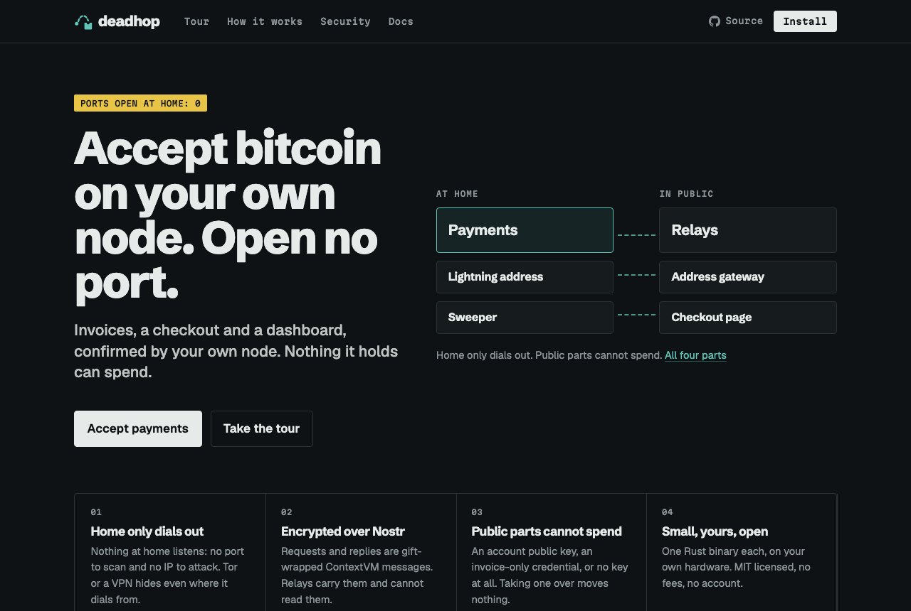
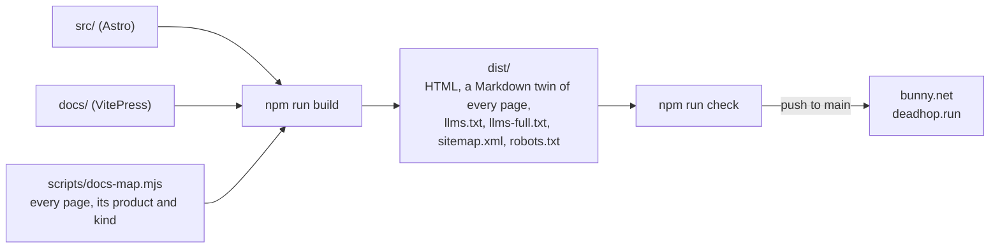
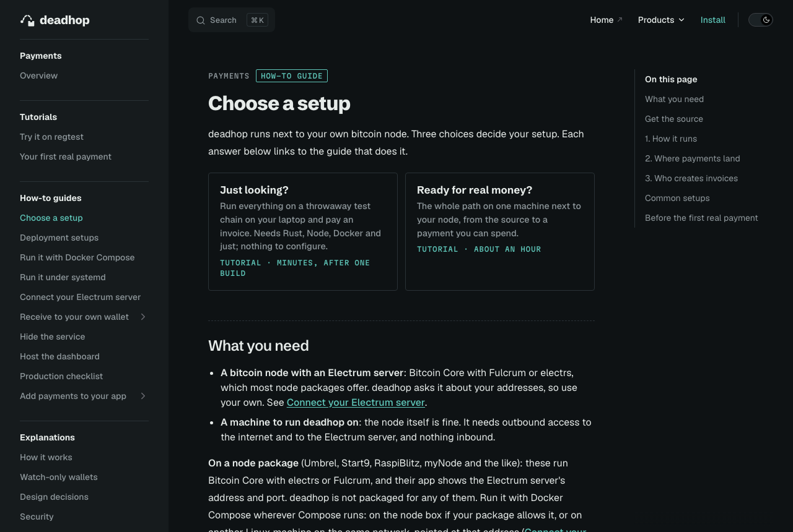

<div align="center">

<picture>
  <source media="(prefers-color-scheme: dark)" srcset="https://deadhop.run/docs/mark-fog.svg">
  
</picture>

# deadhop.run

The website and the documentation for every deadhop component.

[](https://github.com/deadhop/site/actions/workflows/site.yml)
[](LICENSE)
[](https://deadhop.run)



</div>

Two sites build into one folder:

- **the landing page and tool pages** (`src/`, [Astro](https://astro.build)): `/`, `/lud16-lnaddr/`,
  `/relay/` and `/wallet/`;
- **the docs** (`docs/`, [VitePress](https://vitepress.dev)), at `/docs/`, for the service
  ([deadhop/server](https://github.com/deadhop/server)), the JavaScript packages and dashboard
  ([deadhop/js](https://github.com/deadhop/js)), [lnaddr](https://github.com/deadhop/lnaddr),
  the [relay](https://github.com/deadhop/relay), the [wallet](https://github.com/deadhop/wallet)
  and [the stack](https://github.com/deadhop/stack).

Doc fixes for any component come here, not to the component's repository.



## Write a page

Every docs page is listed in `scripts/docs-map.mjs` with its product and its kind, after
[Diátaxis](https://diataxis.fr):

| Kind | Its job |
| --- | --- |
| `tutorial` | Learn by doing, start to finish, on a setup chosen for the reader |
| `howto` | Do one job on your own setup |
| `explainer` | Understand how and why it works |
| `reference` | Look something up |

The VitePress sidebars, the kind badge on each page, the "next step" box, `llms.txt`, the
sitemap and the checks all come from that one list, so they cannot disagree. A new page goes in
`docs/` and in the map.

<p align="center">
  
</p>

## Develop

Requirements: Node 24 and [`just`](https://github.com/casey/just).

```sh
just check     # npm ci, build, then scripts/check.mjs
just preview   # serve dist/ at http://127.0.0.1:4330
npm run dev    # the landing page with live reload (npm run docs:dev for the docs)
```

`scripts/check.mjs` runs against `dist/` and fails on a broken internal link, missing metadata
or structured data, an `llms.txt` or sitemap entry that does not resolve, a docs page missing
from the map (or a map entry with no page), or a brand file that drifted. If an `.env.local`
sits in the parent folder, it also makes sure none of its values were published. It also checks that every
`DEADHOP_*` and `LNADDR_*` setting the docs name exists in the source. That last check reads
the other deadhop repositories from the parent folder, as they are laid out in a
[deadhop/stack](https://github.com/deadhop/stack) checkout after `just clone`; a lone clone of
this repository skips it.

`SITE_URL` sets the public origin (canonical links, sitemap, Open Graph, `llms.txt`), and may
include a path. Local builds fall back to the preview server.

```
.
├── .github/workflows/    check.yml (pull requests), site.yml (build, check, deploy)
├── brand/                copies of the fonts, icons, mark and social card, from deadhop/brand
├── docs/                 the VitePress docs, one folder per product (lnaddr/, relay/, wallet/, xpub/)
├── public/               files served as they are: favicon, social card, screenshots (shots/)
├── scripts/
│   ├── build.mjs         Astro, then VitePress, then the Markdown twins and llms.txt
│   ├── check.mjs         the checks
│   ├── docs-map.mjs      every docs page, its product and kind
│   └── site-url.mjs      SITE_URL handling
├── src/                  the Astro landing page and tool pages
├── astro.config.mjs
├── justfile
└── package.json
```

## Deploy

`.github/workflows/site.yml` builds, checks and deploys to bunny.net (site `deadhop`) on every
push to `main`. It reads the `BUNNYNET_API_KEY` secret and the `SITE_URL` repository variable
(`https://deadhop.run`). A deploy is named after its commit's short sha, so after changing
`SITE_URL`, push a commit. Roll back with
`bunny sites deployments publish --previous --force`.

On bunny, `deadhop.run` is a Bunny DNS zone whose apex is a pull-zone record for the site, with
a Let's Encrypt certificate and forced HTTPS. An edge rule serves `*.md` as
`text/markdown; charset=utf-8`.

## Agent skills

This repository ships [agent skills](https://deadhop.run/docs/skills.html) for Claude Code,
Codex, Cursor and other agents that read `SKILL.md`:

```sh
npx skills add deadhop/site
```

| Skill | Use it to |
| --- | --- |
| `deadhop-site-docs` | write or change a deadhop.run docs page: pick its kind, add it to the docs map, and pass `just check` |

Install one with `--skill <name>`. Every deadhop skill is listed on
[Agent skills](https://deadhop.run/docs/skills.html).

## Contributing

Pull requests are welcome; `check.yml` builds and checks every one. Keep to the page's kind: a
how-to guide does one job, and explanations go in an explainer. The brand files in `brand/` are
copies; change [deadhop/brand](https://github.com/deadhop/brand) first.

## License

[MIT](LICENSE).
